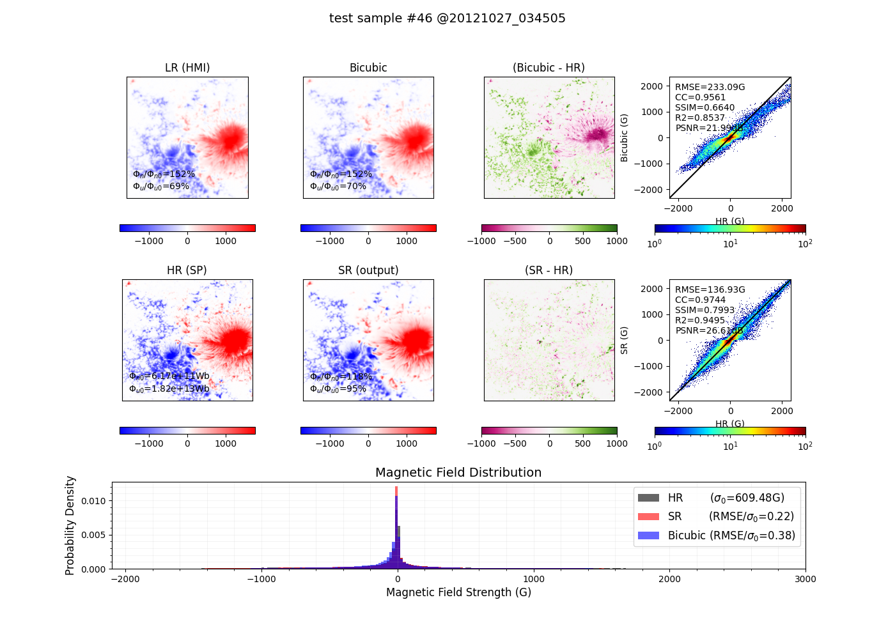
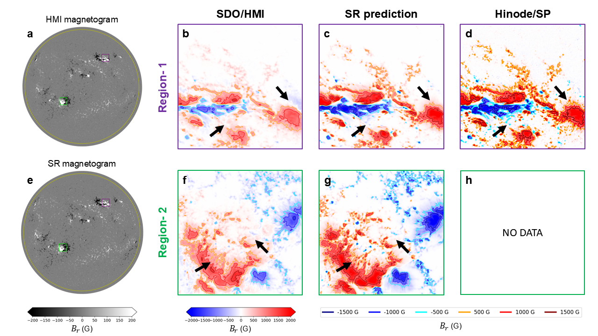
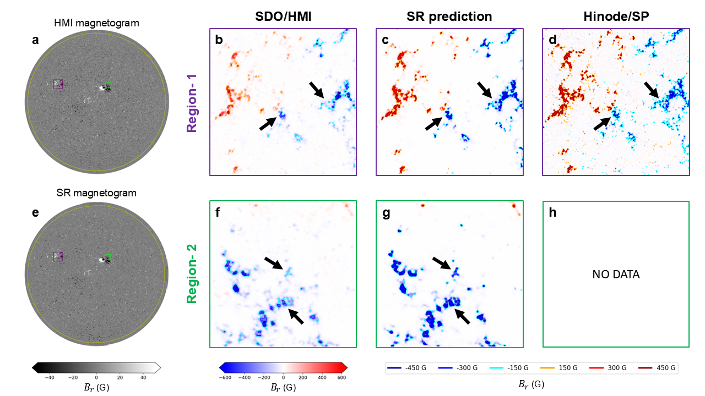

# HMI to Hinode/SP magnetogram reconstruction

Code and pretrained models for **Full-Disk Solar Magnetogram Reconstruction to Hinode/SP Resolution Using an Improved Arbitrary-Scale Super-Resolution Network**. Model names follow manuscript Table 2; **PM-LTEW-CC** is the primary model.

## Code and data availability

| Material | What is accessible |
|---|---|
| Model and processing code | Dataset preparation, six model architectures/configurations, training, patch inference, shared evaluation, and full-disk generation/plotting workflows. |
| Pretrained weights | Six inference checkpoints, selected-checkpoint epochs and SHA-256 checksums in [`pre-trained/`](pre-trained/README.md). The selected epoch is distinct from the 300-epoch training schedule. |
| Dataset membership | The exact [10,115-observation split](data/splits/dataset_split_10115.json): 6,069 training, 2,023 validation and 2,023 test IDs, plus [test metadata](data/test_metadata.csv). |
| Small scientific examples | Three [paired HMI/SP patches](examples/data), three [saved predictions](examples/predictions), and their figures. |
| Full-disk examples | Three [paper figures and observation records](examples/application/README.md), with commands to generate new scientific arrays. |
| Complete scientific arrays | The complete paired training/validation/test dataset, raw FITS collection and full-disk result arrays are not included. No separate downloadable archive or data DOI is currently provided. |

Raw HMI LOS magnetograms are available from [JSOC](https://jsoc.stanford.edu/) (`hmi.M_720s`); Hinode/SP L2 and L2.1 observations are available from [HAO](https://www2.hao.ucar.edu/csac/csac-instruments/sp) and [DARTS](https://data.darts.isas.jaxa.jp/pub/hinode/sot/). The [data-access guide](docs/data_access.md) identifies the sources, required pointing metadata, download requirements and preparation conventions. Recreating the dataset requires downloading those observations and running preprocessing; the generation workflow does not provide the complete processed datasets as direct downloads.

The earlier public-release baseline is [`1ee940fcbf87cbdf16cc3b41805b1fd6e7d20247`](https://github.com/Rui-Zhuo/Magnetogram_SuperResol_by_ML/tree/1ee940fcbf87cbdf16cc3b41805b1fd6e7d20247). See [implementation and provenance](docs/reproducibility.md) for current normalization, position modulation and processing details, and [historical release validation](docs/validation.json) for the earlier checks and their limits. The [PM regression tests](tests/test_position_modulation.py) cover the new PM and checkpoint-compatibility behavior. Historical-result reproduction and remote archive downloads have not been independently verified by those checks.

## Position modulation and checkpoint compatibility

New LTEW models and the released training configurations use the manuscript's patch-center rule: `clip(1 - gamma * r_center / 960 + beta, 0.5, 1.5)`, with the normalized radius multiplied by 200 to restore arcsec. One weight is applied throughout each patch, independent of query chunk size. PM-RCAN-CC and PM-SRCNN-CC use the same center-radius convention.

The distributed LTEW weights are retained unchanged and do not encode a PM-version field. Loading them therefore selects the explicit `legacy_query_min` compatibility path and emits a warning; this preserves the behavior of the earlier public release. To inspect the new PM rule with those tensors, add `--position-mode patch_center` to an inference command. That explicit override changes predictions and is not a verified reproduction of the saved paper results. Newly trained checkpoints record their PM mode and load without this fallback.

The portable decoder retains the two-cell phase-layer format of the supplied checkpoints; it does not provide the ten-feature Jacobian decoder in the research source. No checkpoint weights have been padded, reshaped or retrained. See [implementation details](docs/reproducibility.md) and [checkpoint compatibility metadata](pre-trained/manifest.json).

## Installation

Python 3.10 or newer. Run from the repository root:

```bash
git clone https://github.com/Rui-Zhuo/Magnetogram_SuperResol_by_ML.git
cd Magnetogram_SuperResol_by_ML
python -m pip install -e ".[solar]"
```

## Dataset preparation

The workflow downloads HMI/SP observations, aligns and crops them, and generates paired NPZ files. See [`prep-dataset/`](prep-dataset/README.md) for commands. Three paired examples and the exact train/validation/test split are included; the complete paired dataset must currently be recreated from the source observations.

## Models, training and inference

[`models/`](models) contains the architectures, [`pre-trained/`](pre-trained) the six pretrained models, and [`configs/`](configs/README.md) their training/test settings: **PM-LTEW-CC**, **PM-LTEW**, **LTEW-CC**, **LTEW**, **PM-RCAN-CC** and **PM-SRCNN-CC**. PM denotes position modulation; CC denotes the correlation-coefficient loss term. The LTEW variants share the LTE-warp implementation.

```bash
python -m training.train --config configs/train_pm_ltew_cc.yaml --data data/paired --output outputs/training --device cuda
python -m inference.predict --config configs/test_pm_ltew_cc.yaml
```

Inference defaults to CPU; add `--device cuda` for a CUDA-enabled PyTorch installation. Training requires the prepared dataset; the included examples are sufficient for inference.

## Evaluation and test example

[`evaluation/`](evaluation/README.md) contains one shared set of [metric definitions](docs/metrics.md), the evaluator and plotting tools.

```bash
python -m evaluation.evaluate --predictions outputs/pm_ltew_cc --data examples/data --output outputs/evaluation
```

Existing paired test result, with input, reference and saved prediction in `examples/`:



## Full-disk applications

[`full-disk/`](full-disk/README.md) provides the HMI download → patch inference → assembly → background filling → plotting workflow. [`examples/application/`](examples/application/README.md) contains the three paper-case previews and observation information. Large full-disk FITS/NPZ files are not included in the current tree.

**Solar maximum — Figure 6**



**Solar minimum — Figure 7**



The [quiet-Sun case](examples/application/quiet-sun/paper-figure.png) is shown in the appendix.

## Attribution

Based on [LTEW](https://github.com/jaewon-lee-b/ltew) and [SOT/SP pointing updates](https://github.com/dfouhey/SOTSPPointing). Code is distributed under the [BSD 3-Clause license](LICENSE), with upstream notices in [`third_party/`](third_party/README.md). Please cite the accompanying manuscript, upstream methods and data sources; machine-readable software citation metadata are in [`CITATION.cff`](CITATION.cff). Source observations retain their original archive attribution requirements; see [data access](docs/data_access.md).
